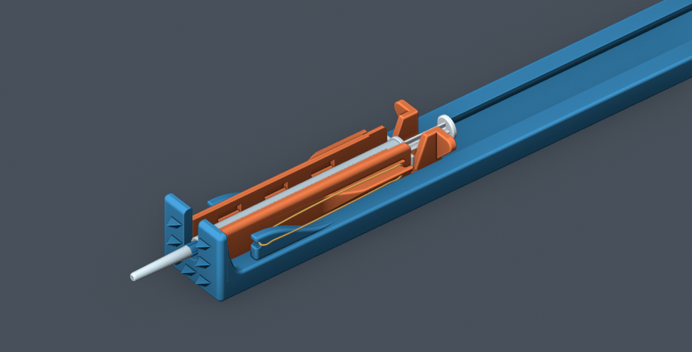

An autoinjector for the [BD 1 mL Luer-Lok syringe (309628)](https://www.bd.com/en-us/products-and-solutions/products/product-page.309628). Designed for one-handed glute injections and adaptable to other sites and grips. It prints as two monolithic parts without supports. Rubber bands power needle insertion. The poking points on the contact surface are inspired by [ShotBlocker](https://bionix.com/products/shotblocker) and are meant to distract from the needle poke. Your favorite LLM can probably help adapt the model to another syringe size.

## Build

Ready-to-print files: [sled.stl](print/sled.stl) and [track.stl](print/track.stl).

```sh
python -m pip install cadquery==2.8.0
python autoinjector.py
```

The script writes STEP and STL files for both parts to `output/`.


